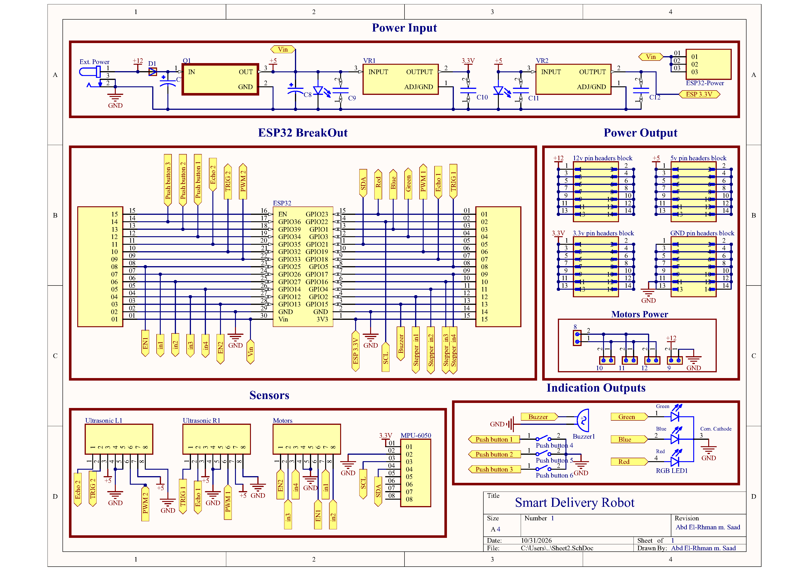
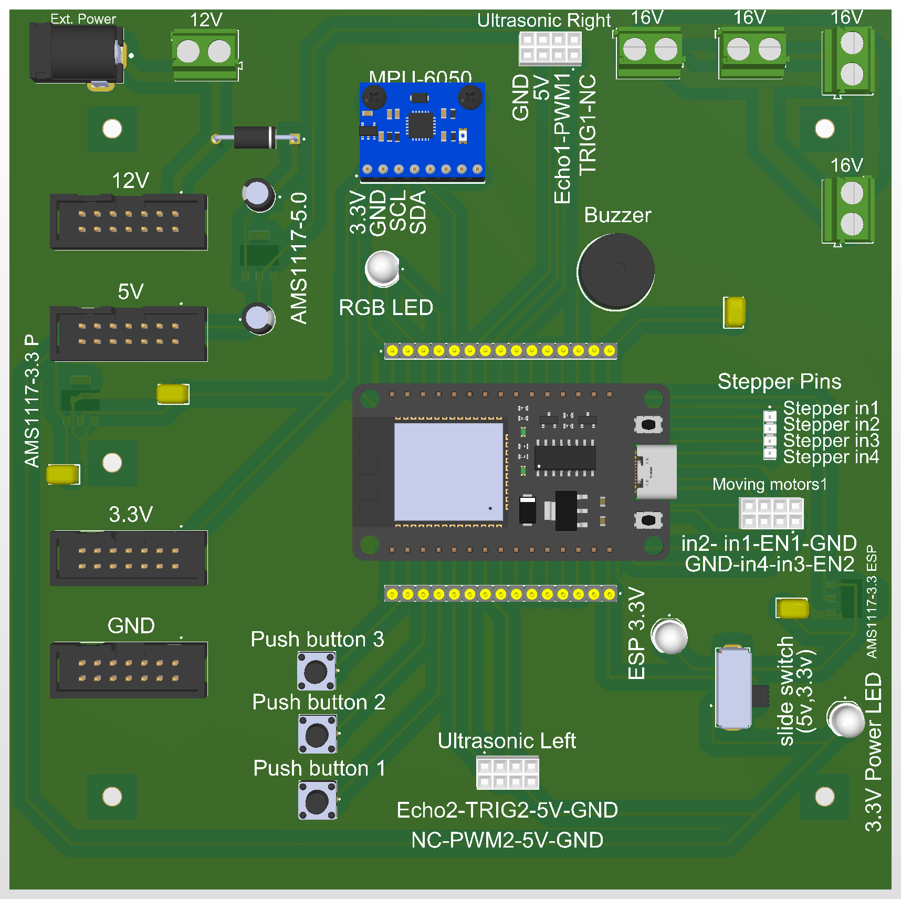
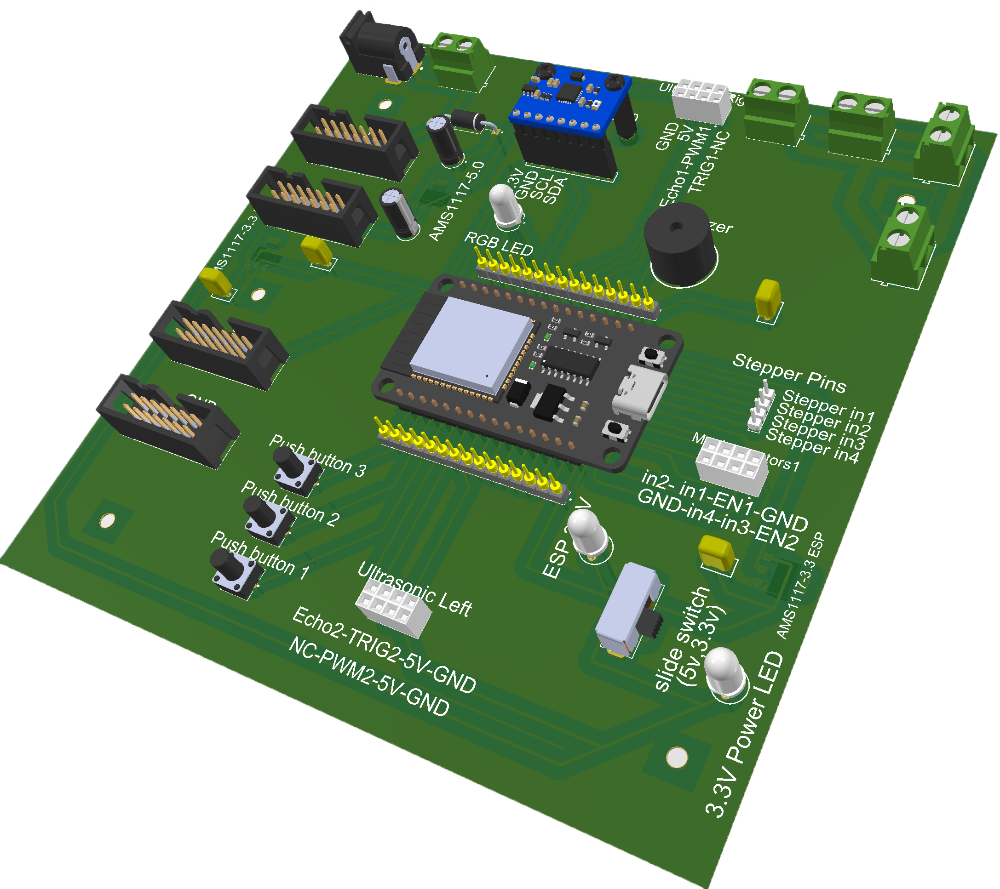
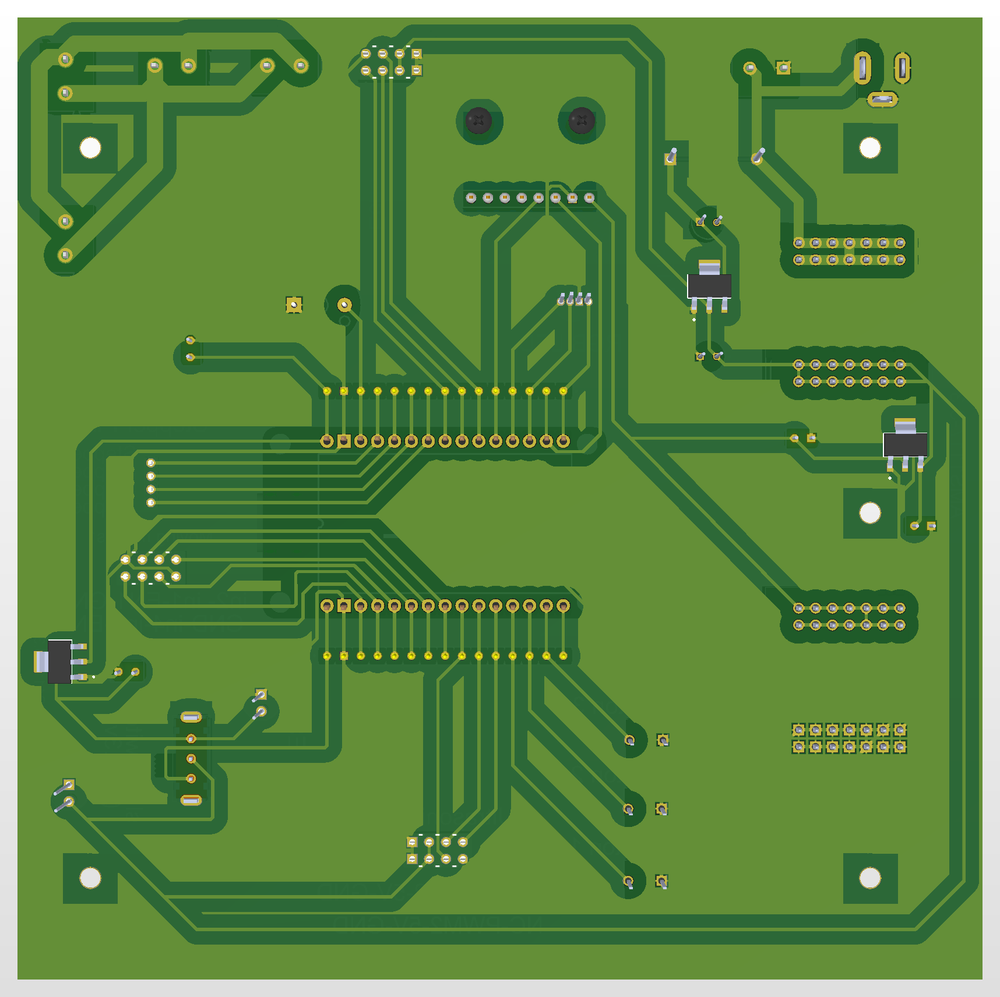
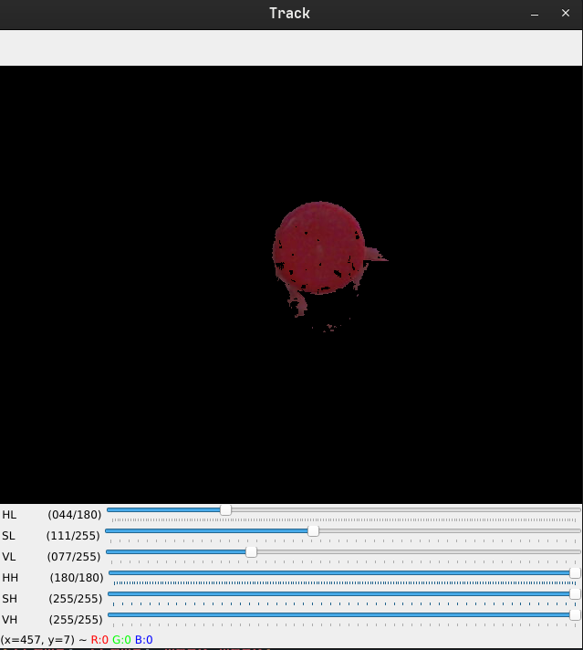

# Smart Delivery Robot: Custom ESP32 Carrier Board PCB Design, In-House Fabrication & Embedded Hardware Architecture

<p align="center">
  
  
  
  
  
  
  
</p>

> **Hardware Lead & PCB Design Engineer:** Abd El-Rhman Muhammad Saad (ID: 19017058)  
> **Academic Institution:** Faculty of Engineering, Alexandria University (Class of 2026)  
> **Department:** Electrical Engineering Department (Power & Machines Section)  
> **Project Title:** *Autonomous Smart Delivery Robot: Custom ESP32 Carrier Board PCB Design, Fabrication, Power Architecture & Sensor-Actuator Integration*  
> **Hardware Engineering Scope:** Complete Schematic Capture (Altium Designer), 2-Layer PCB Layout, Chemical Etching Fabrication, Hand Soldering Assembly & Hardware Bring-Up  
> **Software & Perception Reference:** Team Vision & Object Detection Modules (OpenCV / YOLOv8)  
> **Project Repository:** [Smart-Delivery-Robot on GitHub](https://github.com/Abd-El-Rhman-Saad/Smart-Delivery-Robot)

---

## 📌 Architectural Overview



> **📐 Schematic Versioning & Design Evolution Note:**  
> The Altium Designer project document structure reflects the iterative engineering design lifecycle:
> - **`Sheet1.SchDoc` (Concept Draft):** Preliminary working draft and scratchpad capture used during initial component selection and pin-mapping feasibility checks.
> - **`Sheet2.SchDoc` (Final Production Schematic):** The finalized, approved, and physically fabricated master design (`Drawn By: Abd El-Rhman m. Saad`), incorporating dual-rail LDO regulation (AMS1117-5.0 & AMS1117-3.3), high-frequency bypass decoupling, star-point grounding, and multi-sensor/actuator headers.

This repository documents the complete **hardware engineering, electronic design automation (EDA), manual fabrication lifecycle, and embedded hardware bring-up** of the custom **Central Carrier Board / Motherboard** for an autonomous indoor **Smart Delivery Robot**.

Mobile autonomous robots frequently suffer from intermittent electrical failures, loose jumper wires, and microcontroller brownout resets caused by mechanical vibration and motor-induced electrical noise. To overcome these limitations, this project replaces temporary solderless breadboards with a **custom 2-layer printed circuit board (PCB)** designed from scratch in **Altium Designer**, fabricated in-house via **chemical ferric chloride etching**, hand-soldered, and bench-validated under dynamic motor loads.

The carrier board acts as the central electronic nervous system of the mobile robot, providing structured multi-voltage power regulation, high-frequency bypass filtering, an isolated socket for an **ESP32-WROOM-32** microcontroller, an onboard **MPU-6050 6-DOF IMU** motion-tracking interface, dual servo-actuated ultrasonic distance scanning channels, multi-channel motor driver breakout headers, and status diagnostics.

---

## 👨‍💻 Engineering Scope & Team Division of Responsibility

To maintain rigorous technical transparency, the division of engineering responsibilities within the project team is detailed below:

### 1. Hardware Engineering (Abd El-Rhman Muhammad Saad — Sole Hardware Responsibility)
- **Schematic Capture:** Designed the full electrical schematic in Altium Designer (`Drawn By: Abd El-Rhman m. Saad`), selecting components, decoupling networks, and protective circuitry.
- **PCB Layout & Routing:** Engineered the 2-layer board layout, optimizing high-current motor traces, star-point grounding, signal integrity for $I^2C$ buses, and mounting hole clearances.
- **In-House Chemical Fabrication:** Executed photolithographic toner transfer, chemical ferric chloride ($\text{FeCl}_3$) etching, manual drilling (0.8 mm, 1.0 mm, 3.0 mm), and copper surface preparation.
- **Assembly & Hand Soldering:** Hand-soldered all surface-mount voltage regulators (SOT-223), electrolytic reservoir capacitors, ceramic bypass filters, terminal blocks, pin headers, pushbuttons, and LEDs.
- **Hardware Bring-Up & Electrical Validation:** Conducted cold continuity probing, power rail regulation testing ($3.3\text{ V}\pm 2\%$, $5.0\text{ V}\pm 2\%$), ground isolation checks, and dynamic load stress tests.

### 2. Software & Perception Reference Modules (Team Collaborative Contribution)
- **Host-Side Vision Algorithms:** Software team members developed host-side Python scripts utilizing **OpenCV** (HSV color space thresholding and contour extraction) and **YOLOv8** object detection to identify target packages and track delivery waypoints.
- **Camera Streaming:** A mobile smartphone mounted on the robot chassis streamed live video over a local Wi-Fi access point to a host laptop executing the vision processing.
- *These perception reference scripts are preserved in the `Software_Reference/` directory to document the end-to-end operational context of the robot.*

---

## ⚙️ Hardware Specifications & Bill of Materials (BOM)

The carrier board integrates commercial off-the-shelf (COTS) active components and passives sized for rugged mobile robotics:

| Subsystem | Component / IC | Package / Form Factor | Electrical Specification & Function |
| :--- | :--- | :--- | :--- |
| **Compute Core** | ESP32-WROOM-32 | 30-Pin Dual-In-Line Socket | 240 MHz dual-core Tensilica Xtensa LX6, Wi-Fi 802.11 b/g/n, Bluetooth v4.2 BR/EDR |
| **Primary DC Input** | Screw Terminal Block | 2-Pin 5.08 mm Pitch | Unregulated DC power input from external robot battery pack ($12.0\text{ V} - 16.0\text{ V DC}$) |
| **Polarity Protection** | Power Rectifier Diode | DO-41 / DO-214 | Series reverse-polarity protection preventing reverse voltage damage during battery connection |
| **Logic Regulator (5V)** | AMS1117-5.0 | SOT-223 / TO-252 | Regulates battery voltage to $+5.0\text{ V DC}$ ($\pm 1.5\%$, up to $1.0\text{ A}$) for sensors and servos |
| **MCU Regulator (3.3V)**| AMS1117-3.3 | SOT-223 / TO-252 | Dedicated ultra-low ripple $+3.3\text{ V DC}$ rail powering ESP32 logic and MPU-6050 IMU |
| **Bulk Capacitors** | Electrolytic Capacitors | Radial Can ($16\text{ V}$ rated) | $100\ \mu\text{F} - 470\ \mu\text{F}$ bulk reservoir filtering motor transient voltage dips |
| **Decoupling Filters** | Ceramic Capacitors | 0805 / Radial Monolithic | $100\text{ nF}$ ($0.1\ \mu\text{F}$) high-frequency ceramic bypass capacitors across each IC power pin |
| **Motion Tracking** | MPU-6050 6-Axis IMU | 8-Pin Breakout Header | 3-axis accelerometer ($\pm 16g$) + 3-axis gyroscope ($\pm 2000^\circ/\text{s}$) over hardware $I^2C$ |
| **Distance Sensing** | Dual Ultrasonic Headers | $2\times$ 4-Pin Female Headers | Left & Right HC-SR04 sonar interfaces (`TRIG1/ECHO1` and `TRIG2/ECHO2`) |
| **Panning Sweepers** | Dual Servo Headers | $2\times$ 3-Pin Male Headers | PWM actuation channels (`PWM1`, `PWM2`) for $180^\circ$ panoramic sonar scanning |
| **Drive Motor Interface**| DC Motor Driver Header | 8-Pin Female Header | Direction and PWM speed control signals (`IN1, IN2, EN1, IN3, IN4, EN2`) for external H-Bridge |
| **Stepper Interface** | Stepper Driver Header | 4-Pin Male Header | Step sequence signals (`Stepper in1` through `in4`) for auxiliary positioning motors |
| **User Input** | Tactile Push Buttons | $3\times$ SPST Momentary Buttons | Mode selection, navigation trigger, and manual hardware reset/calibration |
| **Acoustic Indicator** | Active Piezo Buzzer | 12 mm Through-Hole | Audible alarm indicating payload arrival, obstacle warning, or low battery |
| **Optical Telemetry** | Common-Cathode RGB LED | 4-Pin 5 mm LED | Multi-state visual beacon (Green = Running, Blue = Wi-Fi Connected, Red = Obstacle Detected) |
| **Voltage Select Switch**| Mini Slide Switch | 3-Pin SPDT | User-selectable logic voltage routing ($5.0\text{ V} \leftrightarrow 3.3\text{ V}$) for auxiliary expansion |

---

## 🔌 Circuit Subsystems & Power Distribution Architecture

```
+---------------------------------------------------------------------------------------------------+
|                                 CARRIER BOARD POWER ARCHITECTURE                                  |
|                                                                                                   |
|  [External Battery Pack: 12V-16V DC]                                                              |
|                 |                                                                                 |
|                 v                                                                                 |
|      +----------------------+                                                                     |
|      | Reverse Diode Prot.  |                                                                     |
|      +----------+-----------+                                                                     |
|                 |                                                                                 |
|                 +-----------------------------------+-----------------------------------------+   |
|                 |                                   |                                         |   |
|                 v                                   v                                         v   |
|      +----------------------+           +----------------------+                 +--------------------+
|      |    12V Motor Rail    |           |    AMS1117-5.0 LDO   |                 |  AMS1117-3.3 LDO   |
|      | High-Current Supply  |           | Linear Regulator     |                 | Linear Regulator   |
|      | C_bulk: 16V Electro. |           | C_in/C_out: 100nF    |                 | Dedicated Clean    |
|      +----------+-----------+           +-----------+----------+                 +----------+---------+
|                 |                                   |                                       |     |
|                 v                                   v                                       v     |
|         [DC Motor H-Bridge]                [Dual Ultrasonic Sens.]                    [ESP32 MCU Core]    |
|         [Stepper Actuators]                [Dual Panning Servos]                      [MPU-6050 6-DOF IMU]|
|                                            [Active 5V Buzzer]                         [RGB Status Ind.]   |
|                                                                                                   |
|  [Star-Point Common Ground Reference (GND)] <====================================================+
+---------------------------------------------------------------------------------------------------+
```

### 1. Multi-Rail Power Isolation & Transient Suppression
Mobile robots draw heavy, pulsating currents when DC drive motors start, reverse, or stall. Without isolated regulation, these motor transients back-propagate into the digital logic, causing the microcontroller to brown out. The carrier board solves this by:
- **Dedicated Independent 3.3V Rail:** The `AMS1117-3.3` regulator is isolated from inductive switching, supplying an ultra-clean $3.3\text{ V}$ rail solely to the ESP32 and MPU-6050.
- **Decoupled 5.0V Sensor Rail:** An independent `AMS1117-5.0` feeds the ultrasonic sensors, buzzer, and servo sweepers.
- **Bulk Energy Reservoirs:** High-capacitance $16\text{ V}$ radial electrolytic capacitors act as instantaneous local charge reservoirs, buffering voltage drops during motor acceleration.
- **High-Frequency Bypassing:** Multiple $100\text{ nF}$ surface-mount ceramic capacitors placed immediately adjacent to regulator pins attenuate high-frequency parasitic noise.

### 2. Sensor & Actuator Pin Allocation Matrix

| ESP32 Pin | GPIO Pin | Circuit Net | Interface Category | Operating Voltage | Subsystem Connection |
| :---: | :---: | :--- | :--- | :---: | :--- |
| **Pin 1** | 3V3 | `ESP 3.3V` | Regulated Power | $3.3\text{ V DC}$ | ESP32 internal logic & MPU-6050 VDD |
| **Pin 2** | GND | `GND` | Ground | $0\text{ V}$ | Star-point digital common ground plane |
| **Pin 3** | GPIO15 | `POBuzzer` | Digital Output | $3.3\text{ V} \to 5\text{ V}$ | Active Piezo Buzzer transistor drive |
| **Pin 4** | GPIO2 | `POSteper_in1` | Digital Output | $3.3\text{ V}$ | Stepper Motor Driver Input 1 |
| **Pin 5** | GPIO4 | `POSteper_in2` | Digital Output | $3.3\text{ V}$ | Stepper Motor Driver Input 2 |
| **Pin 6** | GPIO16 | `POSteper_in3` | Digital Output | $3.3\text{ V}$ | Stepper Motor Driver Input 3 |
| **Pin 7** | GPIO17 | `POSteper_in4` | Digital Output | $3.3\text{ V}$ | Stepper Motor Driver Input 4 |
| **Pin 8** | GPIO5 | `POEN1` | Hardware PWM | $3.3\text{ V}$ | DC Motor 1 Speed Enable (H-Bridge) |
| **Pin 9** | GPIO18 | `POin1` | Digital Output | $3.3\text{ V}$ | DC Motor 1 Direction Phase A |
| **Pin 10** | GPIO19 | `POin2` | Digital Output | $3.3\text{ V}$ | DC Motor 1 Direction Phase B |
| **Pin 11** | GPIO21 | `POSDA` | Hardware $I^2C$ | $3.3\text{ V}$ | MPU-6050 Serial Data with pull-up |
| **Pin 12** | GPIO3 | `U0RXD` | UART Serial | $3.3\text{ V}$ | USB-UART flashing & diagnostic logging |
| **Pin 13** | GPIO1 | `U0TXD` | UART Serial | $3.3\text{ V}$ | USB-UART flashing & diagnostic logging |
| **Pin 14** | GPIO22 | `POSCL` | Hardware $I^2C$ | $3.3\text{ V}$ | MPU-6050 Serial Clock with pull-up |
| **Pin 15** | GPIO23 | `POin3` | Digital Output | $3.3\text{ V}$ | DC Motor 2 Direction Phase A |
| **Pin 16** | EN | `EN` | Reset / Enable | $3.3\text{ V}$ | Master hardware reset pin |
| **Pin 23** | GPIO25 | `POTRIG1` | Digital Output | $3.3\text{ V} \to 5\text{ V}$ | Left Ultrasonic Sensor Trigger pulse |
| **Pin 24** | GPIO26 | `POEcho1` | Digital Input | $5\text{ V}$ tolerant | Left Ultrasonic Sensor Echo pulse |
| **Pin 25** | GPIO27 | `POPWM1` | Hardware PWM | $5\text{ V}$ | Left Ultrasonic Panning Servo sweep |
| **Pin 26** | GPIO14 | `POTRIG2` | Digital Output | $3.3\text{ V} \to 5\text{ V}$ | Right Ultrasonic Sensor Trigger pulse |
| **Pin 27** | GPIO12 | `POEcho2` | Digital Input | $5\text{ V}$ tolerant | Right Ultrasonic Sensor Echo pulse |
| **Pin 28** | GPIO13 | `POPWM2` | Hardware PWM | $5\text{ V}$ | Right Ultrasonic Panning Servo sweep |
| **Pin 29** | GND | `GND` | Ground | $0\text{ V}$ | Secondary ground pin return |
| **Pin 30** | Vin | `Vin` | Power Input | $5\text{ V} - 12\text{ V}$ | Raw DC supply rail from power switch |

---

## 🛠️ In-House PCB Fabrication & Assembly Lifecycle

The carrier board was physically fabricated, assembled, and validated through an intensive hands-on prototyping workflow:

```
+---------------------------------------------------------------------------------------------------+
|                                 PHYSICAL FABRICATION WORKFLOW                                     |
|                                                                                                   |
|  [Altium 1:1 CAD Export]                                                                          |
|            |                                                                                      |
|            v                                                                                      |
|  [Laser Printing on Glossy Transfer Film]                                                         |
|            |                                                                                      |
|            v                                                                                      |
|  [Thermal Laminator Heat Press onto Copper Clad FR4]                                              |
|            |                                                                                      |
|            v                                                                                      |
|  [Chemical Etching: Ferric Chloride (FeCl3) Bath @ 45 deg C with Continuous Agitation]            |
|            |                                                                                      |
|            v                                                                                      |
|  [Acetone Toner Stripping, Micro-Inspection & Rosin Flux Coating]                                 |
|            |                                                                                      |
|            v                                                                                      |
|  [Precision Drill Pressing: 0.8 mm (Signals), 1.0 mm (Headers), 3.0 mm (Mounting)]                |
|            |                                                                                      |
|            v                                                                                      |
|  [Manual Hand Soldering: SOT-223 Regulators -> Passives -> Headers -> Power Terminals]            |
|            |                                                                                      |
|            v                                                                                      |
|  [Multi-Stage Electrical Bring-Up: Short Checks -> Unloaded Power -> Full Sensor Stress]          |
+---------------------------------------------------------------------------------------------------+
```

### 1. Photolithography & Chemical Etching
- **Copper Clad Preparation:** Single/double-sided FR-4 copper-clad laminate was scrubbed with fine abrasive pads, degreased with isopropyl alcohol (IPA), and dried.
- **Toner Transfer:** High-resolution 1:1 artwork was printed using high-density toner on glossy transfer paper and thermally fused onto the copper foil via controlled heated lamination.
- **Chemical Etching:** Immersed in a heated ferric chloride ($\text{FeCl}_3$) bath with constant mechanical agitation until all unprotected copper was etched cleanly without over-etching fine signal traces.
- **Stripping & Flux Protection:** Toner was stripped with acetone, inspected under optical magnification for trace bridges or hairline fractures, and coated with liquid rosin flux to prevent oxidation and facilitate soldering.

### 2. Drilling & Mechanical Alignment
- Standard signal vias and IC pins were precision-drilled with **0.8 mm** solid carbide drill bits.
- Pin headers, power diodes, and terminal blocks were drilled with **1.0 mm** bits.
- Mechanical chassis mounting holes at the board corners were drilled with **3.0 mm** bits for rigid vibration dampening on the robot chassis.

### 3. Component Assembly & Hand Soldering
- **Assembly Hierarchy:** Soldered lowest-profile components first (surface-mount SOT-223 `AMS1117` regulators and bypass capacitors), followed by resistors, LEDs, tactile buttons, electrolytic capacitors, dual-in-line female headers, and heavy screw terminals.
- **Thermal Sinks & Thermal Relief:** Applied adequate heat dwell time on ground-plane pads to ensure shiny, concave solder fillets without cold solder joints or delamination.

### 4. Rigorous Hardware Bring-Up Checklist
1. **Cold Continuity & Resistance Check:** Verified $> 100\text{ k}\Omega$ between $+12\text{V}$, $+5\text{V}$, $+3.3\text{V}$, and $GND$ prior to connecting any power source to prevent short-circuit damage.
2. **Unloaded Power Rail Validation:** Connected a current-limited bench power supply ($12.0\text{ V}$, current limit $100\text{ mA}$) with no ICs socketed. Probed regulator outputs using a calibrated digital multimeter:
   - Measured 5.0V Rail: **$5.02\text{ V DC}$** (well within $\pm 2\%$ tolerance).
   - Measured 3.3V Rail: **$3.31\text{ V DC}$** (well within $\pm 1.5\%$ tolerance).
3. **Loaded Dynamic Commissioning:** Socketed the ESP32 and MPU-6050, activated the dual ultrasonic panning servos, and verified with an oscilloscope that voltage ripple remained $< 30\text{ mV}_{\text{p-p}}$ under active servo sweeping.

---

## 🖼️ PCB Layout & Electrical Drawings

| 2D Component Placement & Silkscreen Overlay | 2D Copper Routing & Power Planes |
| :---: | :---: |
|  |  |

| Drill Hole Guide & Pad Geometry | Full Motherboard Schematic Diagram |
| :---: | :---: |
|  |  |

---

## 👁️ Software & Perception Reference Modules (Team Contribution)

To support the delivery robot's autonomous operations, the software sub-team developed vision-based package recognition and target tracking scripts, included in `Software_Reference/`:

### 1. Real-Time HSV Color Space Tracking (`HSV_Color_Tracking/`)
- **`working_script.py`:** Reads live camera frames streamed over Wi-Fi from the smartphone, converts BGR frames to the HSV color space, applies calibrated dual-range threshold masks for red delivery boxes, extracts external contours, and computes dynamic bounding boxes in real time.
- **`helper.py`:** An interactive OpenCV GUI trackbar tool that allows field calibration of hue (`HL, HH`), saturation (`SL, SH`), and value (`VL, VH`) thresholds under varying ambient lighting conditions.

| Live Camera HSV Color Tracking & Bounding Box Extraction |
| :---: |
|  |

### 2. Deep-Learning YOLOv8 Object Detection (`YOLOv8_Object_Detection/`)
- **`main.py`:** Deploys a customized **YOLOv8** lightweight neural network using PyTorch / Ultralytics. Loads the trained weights file **`best.pt`** ($6.2\text{ MB}$), processes live video frames, filters detections with confidence score $> 0.5$, and draws target classification bounding boxes.
- **`YOLOV8_train_on_colab.ipynb`:** Google Colab training notebook detailing the dataset labeling, hyperparameter tuning, and model weight export pipeline.

---

## 📂 Repository Structure

```plaintext
Smart-Delivery-Robot/
├── Hardware/
│   ├── Altium_Design/                          # Master Altium Designer source CAD files
│   │   ├── Robot_Project.PrjPcb                # Project master configuration file
│   │   ├── Robot_Project.PrjPcbStructure       # Document hierarchy database
│   │   ├── Sheet2.SchDoc                       # Final approved production schematic (Drawn by: Abd El-Rhman Saad)
│   │   ├── Sheet1_draft.SchDoc                 # Early concept draft & scratchpad
│   │   ├── PCB1.PcbDoc                         # Complete 2-layer physical PCB layout & routing
│   │   ├── Project Logs for Robot_Project/     # ECO logs and DRC reports
│   │   └── History/                            # Sequential backup archives
│   └── Fabrication_Outputs/                    # Ready-to-print vector PDFs for in-house manufacturing
│       ├── Robot_Project.pdf                   # Multi-sheet schematic (Sheet 1 = Draft, Sheet 2 = Final Design)
│       └── Schematic Prints.pdf                # Vector schematic printout of final Sheet 2
├── Software_Reference/                         # Team perception & computer vision modules (Reference)
│   ├── HSV_Color_Tracking/
│   │   ├── working_script.py                   # Real-time camera video stream HSV box tracking
│   │   ├── hsv_contour.py                      # Standalone static image contour extraction test
│   │   ├── helper.py                           # Interactive OpenCV GUI HSV slider calibration tool
│   │   ├── cub.jpg                             # Test calibration package image
│   │   └── range.png                           # Calibrated HSV mask output screenshot
│   └── YOLOv8_Object_Detection/
│       ├── main.py                             # Live webcam/phone stream YOLOv8 detection runner
│       ├── best.pt                             # Trained YOLOv8 neural network weights (6.2 MB)
│       └── YOLOV8_train_on_colab.ipynb         # Google Colab model training and export notebook
├── images/                                     # High-resolution documentation and CAD renders
│   ├── Schematic_01_Motherboard_Circuit.png    # High-res A4 schematic diagram print
│   ├── PCB_01_Component_Placement.png          # 2D component placement and silkscreen overlay
│   ├── PCB_02_Copper_Routing.png               # 2D copper traces, track widths and net routing
│   ├── PCB_03_Pad_Layout_Drill.png             # Pad layout, via placements and drill guide
│   └── Vision_01_HSV_Color_Tracking.png        # Color segmentation and tracking output
└── README.md                                   # Comprehensive engineering documentation
```

---

## 🚀 Reproduction & Fabrication Guide

### 1. Opening the Altium Designer Project
1. Clone the repository:
   ```bash
   git clone https://github.com/Abd-El-Rhman-Saad/Smart-Delivery-Robot.git
   cd Smart-Delivery-Robot
   ```
2. Launch **Altium Designer** (Release 20 or newer).
3. Open `Hardware/Altium_Design/Robot_Project.PrjPcb`.
4. Inspect **`Sheet2.SchDoc`** for the final production schematic (`Sheet1.SchDoc` is preserved as an early conceptual draft) and compile the project (`Project -> Compile PCB Project`).
5. Inspect the 2D PCB layout, trace clearances, and design rule checks (`Tools -> Design Rule Check`).

### 2. In-House Chemical Etching Reproduction
1. Open `Hardware/Fabrication_Outputs/PCB1.pdf`.
2. Print the bottom copper layer at **100% scale (no scaling)** on glossy toner transfer paper.
3. Clean and polish the copper clad board, then heat-press the toner at $180^\circ\text{C}$ for 3–5 minutes.
4. Etch in ferric chloride ($\text{FeCl}_3$) solution until unmasked copper dissolves completely.
5. Drill all pad holes with a precision drill press using the bits specified in Section 4.
6. Hand-solder components starting with the lowest profile SMT voltage regulators, followed by headers and terminal blocks.
7. Perform the cold multimeter continuity and power rail validation checks before powering with an active microcontroller.

---

## 🏛️ Academic Context & Engineering Attribution

This project was developed within the academic curriculum of the **Department of Electrical Engineering, Faculty of Engineering, Alexandria University**:

- **Institution:** Faculty of Engineering, Alexandria University
- **Degree Program:** B.Sc. in Electrical Power and Machines Engineering
- **Hardware Lead & PCB Designer:** **Abd El-Rhman Muhammad Saad Muhammad** (ID: 19017058) — *Responsible for complete schematic capture, PCB layout, physical chemical etching, hand soldering, and electrical commissioning.*
- **Software Collaborators:** Engineering project team members responsible for high-level ROS navigation and OpenCV perception scripts.
- **Academic Year:** 2026

---

## 📄 License

This repository is licensed under the [MIT License](LICENSE) - free for academic, maker, and educational reproduction with proper hardware engineering attribution.

---

## 📬 Contact & Author Details

[](https://linkedin.com/in/Abd-El-Rhman-Saad)
[](https://github.com/Abd-El-Rhman-Saad)
[](mailto:abdelrhmanmsaad22@gmail.com)
